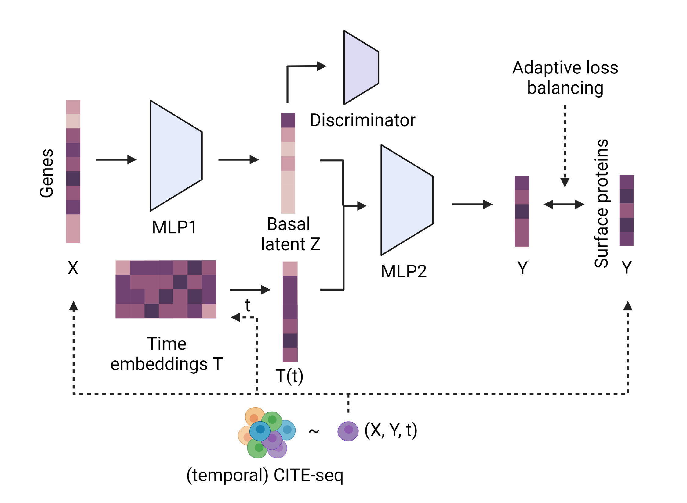

# CrossmodalNet

[](https://github.com/yjgeno/crossmodalnet/actions/workflows/test.yml)
[](https://pypi.org/project/crossmodalnet/)
[](https://pypi.org/project/crossmodalnet/)
[](LICENSE)

Interpretable modeling of time-resolved single-cell gene–protein expression.

> **Preprint:** [biorxiv.org/content/10.1101/2023.05.16.541011v2](https://www.biorxiv.org/content/10.1101/2023.05.16.541011v2)

<p align="center">
    
</p>

CrossmodalNet is a PyTorch-based autoencoder that predicts protein surface abundance (CITE-seq ADT) from scRNA-seq gene expression, incorporating a time/condition embedding and an adversarial discriminator to disentangle temporal variation. Saliency maps expose the gene–protein regulatory links learned by the model.

---

## Install

```shell
pip install crossmodalnet
```

Optional extras:

| Extra | What it adds |
|---|---|
| `pip install "crossmodalnet[tune]"` | Ray Tune hyperparameter search |
| `pip install "crossmodalnet[magic]"` | MAGIC imputation preprocessing |
| `pip install "crossmodalnet[viz]"` | mycolorpy color palettes for saliency plots |
| `pip install "crossmodalnet[dev]"` | pytest · ruff · build · twine |

**Requires Python ≥ 3.10.**

---

## Quick start

### 1 · Prepare data

CrossmodalNet expects two paired `.h5ad` files — one for X (genes) and one for Y (proteins) — with matching cell barcodes and a time/condition column in `.obs`:

```
cite_train_x.h5ad   # AnnData: cells × genes  (raw counts or normalized)
cite_train_y.h5ad   # AnnData: cells × proteins (CLR-normalized ADT)
```

Both files must share the same cell index. The `day` (or custom) column in `.obs` encodes the time-point integer for each cell.

### 2 · Train (CLI)

```shell
crossmodalnet-train \
    -x cite_train_x.h5ad \
    -y cite_train_y.h5ad \
    --tkey day \
    -o Adam -n 500 -v \
    --save --save-dir ./out
```

Key flags:

| Flag | Default | Description |
|---|---|---|
| `-x / --data-x` | — | Path to gene expression `.h5ad` |
| `-y / --data-y` | — | Path to protein expression `.h5ad` |
| `--tkey` | `day` | `.obs` column with time labels |
| `-o` | `SGD` | Optimizer (`Adam` or `SGD`) |
| `-n` | `30` | Number of epochs |
| `-b` | `256` | Batch size |
| `-hp` | — | Path to a hyperparameter JSON file |
| `-p` | — | Preprocessing key (`binary`, `standard_0`, `PCA`, `tSVD`, …) |
| `--log-dir` | — | TensorBoard log subdirectory (written under `./logger/`) |
| `--save` | — | Save model weights + hparams after training |
| `--save-dir` | `.` | Output directory for saved artifacts |

### 3 · Train (Python API)

```python
import torch
from crossmodalnet import CrossmodalNet, load_data, sc_Dataset

dataset = sc_Dataset(
    data_path_X="cite_train_x.h5ad",
    data_path_Y="cite_train_y.h5ad",
    time_key="day",
    preprocessing_key="tSVD",   # optional; None keeps raw counts
)
train_loader, val_loader = load_data(dataset, batch_size=256)

model = CrossmodalNet(
    n_input=dataset.n_feature_X,
    n_output=dataset.n_feature_Y,
    time_p=dataset.unique_day,   # e.g. [2, 3, 4, 7]
)
```

### 4 · Inference

```python
import torch
from crossmodalnet import load_model, load_hparams

model = load_model(
    "out/CrossmodalNet.th",
    n_input=13431,
    n_output=134,
    time_p=[2, 3, 4, 7],
    hparams_dict=load_hparams("out/hparams.json"),
)
model.eval()

with torch.no_grad():
    pred_proteins = model(x_tensor, T=time_onehot)   # shape: (cells, proteins)
```

### 5 · Save and load

```python
from crossmodalnet import save_model, save_hparams, load_model, load_hparams

save_model(model, path="./out")           # writes out/CrossmodalNet.th
save_hparams(model, path="./out")         # writes out/hparams.json

model = load_model(
    "out/CrossmodalNet.th",
    n_input=..., n_output=..., time_p=...,
    hparams_dict=load_hparams("out/hparams.json"),
)
```

### 6 · Saliency (gene importance)

```python
from crossmodalnet import saliency

sal = saliency(
    counts=x_tensor,         # (cells, genes) float tensor
    times=t_tensor,          # (cells, n_timepoints) one-hot tensor
    model=model,
    genes=list(dataset.var_names_X),
    proteins=list(dataset.var_names_Y),
)
sal.compute_saliency("CD14")
sal.get_top_genes(k=50, include_TF=True)

ax = sal.plot_top_genes(topk=20)
ax = sal.plot_top_TFs(topk=20)
```

### 7 · Hyperparameter tuning

```shell
pip install "crossmodalnet[tune]"
crossmodalnet-tune \
    -x cite_train_x.h5ad \
    -y cite_train_y.h5ad \
    --trials 50 --max-t 300
```

Or from Python:

```python
from crossmodalnet.tune import run_tune

results = run_tune(
    data_path_x="cite_train_x.h5ad",
    data_path_y="cite_train_y.h5ad",
    trials=50,
)
```

---

## Citation

If you use CrossmodalNet in your work, please cite:

```bibtex
@article{yang2023crossmodalnet,
  title   = {Interpretable modeling of time-resolved single-cell gene-protein expression},
  author  = {Yang, Yongjian and others},
  journal = {bioRxiv},
  year    = {2023},
  doi     = {10.1101/2023.05.16.541011}
}
```

---

## License

© 2023 Yongjian Yang, Texas A&M University. MIT-licensed — see [LICENSE](LICENSE).
